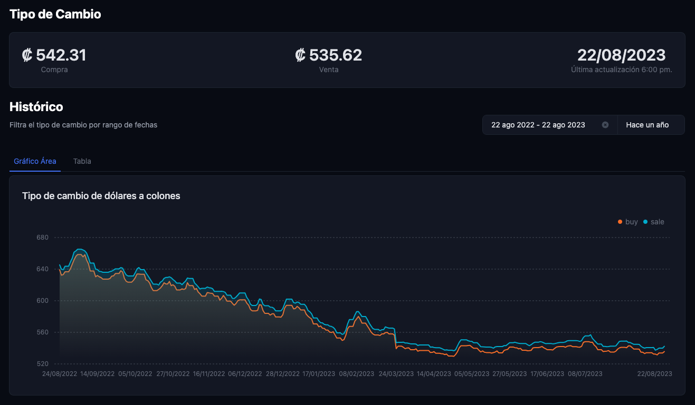
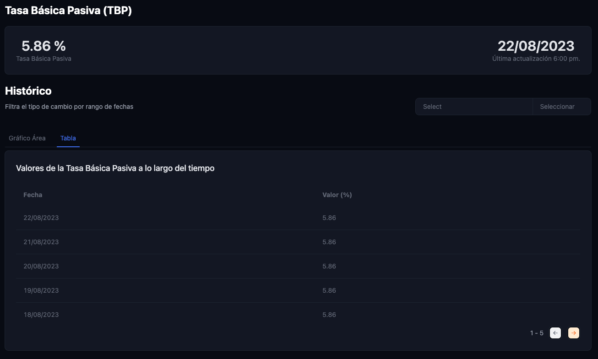
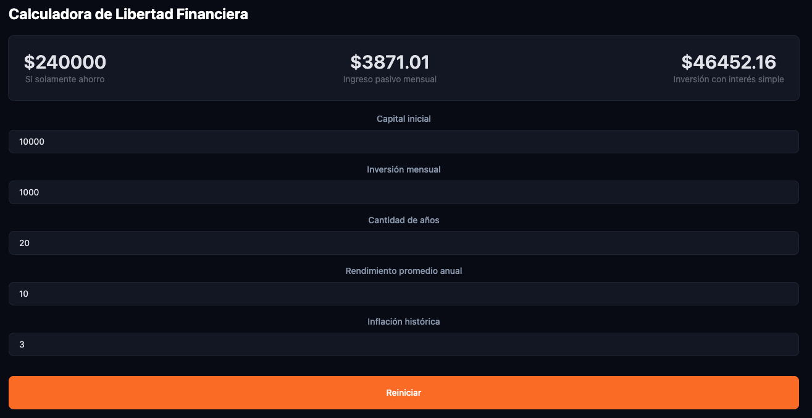

# README Frontend

Do you want to know sources, templates, and more about **Financial Freedom**🤑 based in Costa Rica🇨🇷? Here's the place. 😉

[libertadfinanciera.live](https://www.libertadfinanciera.live/)

Also, I created an [API](https://github.com/jrodolforojas/libertadfinanciera-backend) for that. It's a web scrapper of [Banco Central de Costa Rica](https://www.bccr.fi.cr/SitePages/Inicio.aspx). Check it!🥳

## Sections

### Dollar colones exchange rate

Here you will find the dollar 💸 ➡️ colones 🇨🇷 exchange rates (buy, sale, date). This data are taken from Banco Central de Costa Rica.

### Basic Passive Rate (TBP)

On this page, you will see the basic passive rate values 📊 across the timeline. This data are taken from Banco Central de Costa Rica.

### Financial Freedom Calculator

Calculate how much you need to invest by month or initial capital to get the passive incomes you need to accomplish your financial freedom. The calculator is not mine, is a source of Roberto Olivas’s Opciones de inversión reguladas dentro y fuera de América Latina [course](https://finanzasconrobertoolivas.com/taller-de-opciones-de-inversion-reguladas-dentro-y-fuera-de-america-latina/). 

## Demo

Exchange Rate page

Basic Passive Rate page

Financial Freedom Calculator

